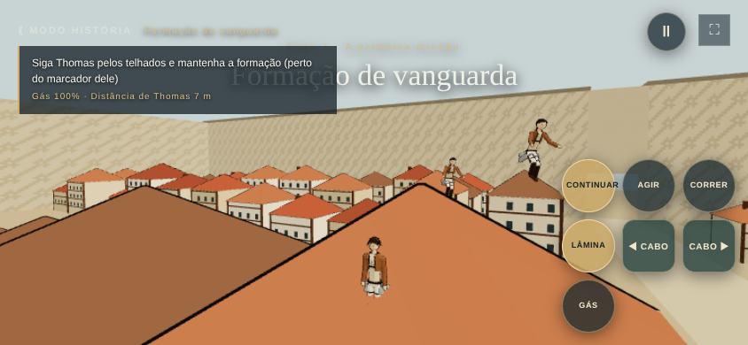

# Plano — controles de celular

Escopo: **somente o perfil de toque** (`data-input=touch`). Teclado, mouse e controle não mudam: nenhuma regra de jogo nova, nenhuma tecla nova e as mesmas suítes de teste continuam passando sem alteração. Tudo que muda fica em `src/touch-controls.js`, `src/touch-controls.css`, um módulo puro novo (`src/touch-layout.js`) e em ramos `input.touch` já existentes.

## Diagnóstico (fase 42, celular deitado 844×390)



1. **Tudo no polegar direito.** No Modo História há 7 botões de 60 px num bloco 3×3 com 8 px de folga: CONTINUAR, AGIR, CORRER, LÂMINA, ◀ CABO, CABO ▶ e GÁS. Em Trost são 7 também (com ABASTECER e SOLTAR). O polegar esquerdo só cuida do analógico.
2. **O cabo exige o dedo parado em cima.** O gancho solta quando o dedo sai do botão (`kit.js`: `if (!input.held[key]) odm.release(side)`; `main.js` faz o mesmo). Para cortar, o polegar direito sai do CABO para a LÂMINA, o cabo solta e o jogador deixa de estar "preso ao titã", condição da janela de finalização (`finisherWindow(..., { onTitan })`). **É por isso que o ataque se perde.**
3. **A câmera também é do polegar direito.** A área de arrastar é os 60 % da direita da tela; segurar GÁS ou CABO e virar a câmera ao mesmo tempo é impossível.
4. **Botões que não servem no momento continuam na tela** (CONTINUAR fora do diálogo, AGIR e ABASTECER longe de qualquer alvo), ocupando o espaço dos que importam.
5. **Arrastar o dedo de um botão para outro não funciona**: cada botão captura o próprio dedo, então rolar o polegar do GÁS para a LÂMINA não corta.

## Referências pesquisadas

- **Call of Duty: Mobile** — editor de layout com arrastar, redimensionar e transparência por botão; disparo também do lado esquerdo para canhotos. Fonte oficial: [Activision, "Getting a Grip on the Call of Duty: Mobile Controls"](https://blog.activision.com/call-of-duty/2019-10/Getting-a-Grip-on-the-Call-of-Duty-Mobile-Controls). Ideia aproveitada: tamanho, transparência e espelhamento ajustáveis; arrastar a partir do botão de disparo vira a câmera.
- **Genshin Impact (celular)** — analógico à esquerda, câmera arrastando com o outro dedo, ataque grande no canto direito e habilidades em arco à volta dele. Críticas registradas: botões pequenos e próximos demais, causando pulos sem querer. Fontes: [Destructoid](https://vip-develop.destructoid.com/?p=260491), [TouchTapPlay](https://www.touchtapplay.com/genshin-impact-mobile-controls-and-settings/). Ideia aproveitada: ação principal maior no canto, secundárias em arco com folga generosa.
- **Jogos de corda/gancho no celular** — dois modelos: segurar para ficar preso (Rope Swing) e **tocar para prender e tocar de novo para soltar** (Hang Line). Fontes: [Rope Swing](https://gamestudiohub.pages.dev/play/rope-swing), [Agent Grapple / Hang Line na App Store](https://apps.apple.com/gb/app/agent-grapple/id1591878072). Ideia aproveitada: cabo fixo por toque, como pedido.
- **Jogos de Attack on Titan feitos por fãs (Roblox)** — cabo esquerdo e direito nos gatilhos/ombros esquerdo e direito do controle; no celular costumam depender de controle externo. Fontes: [guia do AOT Revolution](https://attack-on-titan-revolution-wiki.pages.dev/beginners-guide), [Gamezebo](https://www.gamezebo.com/walkthroughs/attack-on-titan-revolution-controls/). Ideia aproveitada: cabo esquerdo do lado esquerdo e direito do lado direito, como os gatilhos.
- **Boas práticas gerais de toque** — movimento à esquerda e ações à direita, cada dedo rastreado pelo próprio identificador; alvos dimensionados para o polegar; o ponto onde mais se perde um dedo é a troca entre um controle segurado e um gesto novo. Fontes: [Bugnet, QA de controles de toque](https://bugnet.io/blog/qa-testing-for-touch-controls-on-mobile), [Smashing Magazine, The Thumb Zone](https://shop.smashingmagazine.com/2016/09/the-thumb-zone-designing-for-mobile-users).

Nenhuma fonte oficial descreve um esquema de toque de equipamento de manobra 3D; a proposta abaixo combina as ideias acima.

## Proposta

### 1. Cabo fixo no toque

- **Tocar no CABO prende; tocar de novo no mesmo CABO solta.** O dedo pode sair do botão: o gancho continua no titã ou no prédio.
- O cabo também solta sozinho quando o jogo já soltaria hoje: gás acabou, titã morreu, obstáculo cortou o cabo, ou o botão SOLTAR (solta os dois).
- Se o disparo não encontrar ancoragem, o botão não fica preso (aviso "Sem ancoragem" como hoje e vibração dupla curta).
- O botão mostra o estado: aro aceso e texto **PRESO** enquanto o gancho estiver ativo. (Uma cor própria para "preso ao titã" fica para a C2: o Modo História ainda não marca quais malhas são titãs.)
- **Decidido: vale para qualquer ancoragem (titã, prédio, árvore).** A opção de voltar a segurar fica para os ajustes (C4).
- Como funciona sem tocar nos outros modos: o botão de toque continua informando "segurado" enquanto estiver preso, então `kit.js`, `last-charge-chapter.js` e `main.js` não mudam a regra. A página só informa a cada quadro quais ganchos estão ativos (`touch.sync({ left, right })`), para o botão destravar quando o jogo soltar o cabo.

### 2. Nova distribuição (dois polegares)

```
 ┌──────────────────────────────────────────────────────────────┐
 │ objetivo                       gás/lâminas         Ⅱ  ⛶     │
 │                                                              │
 │ [◀ CABO]                                        (SOLTAR)     │
 │   72px                                   [CABO ▶]    (AGIR)  │
 │                                            72px              │
 │      ( analógico                                             │
 │        flutuante )                    [ GÁS ]   [ LÂMINA ]   │
 │                                         76px       88px      │
 └──────────────────────────────────────────────────────────────┘
   polegar esquerdo: mover + cabo esq.   polegar direito: câmera, gás, lâmina, cabo dir.
```

- **Polegar esquerdo:** analógico flutuante (como hoje) e **◀ CABO** acima dele, colado à borda esquerda. Com o cabo fixo, basta um toque rápido e o polegar volta ao analógico.
- **Polegar direito:** **LÂMINA** maior (88 px) no canto inferior direito; **GÁS** (76 px) à esquerda dela; **CABO ▶** (72 px) acima dela, formando um arco.
- **Botões de contexto** (AGIR, ABASTECER, CORRER, SOLTAR) menores (56 px) no anel de fora do arco, e **só aparecem quando servem**: AGIR perto de alguém ou de algo, ABASTECER dentro do raio de abastecimento, SOLTAR com algum cabo preso, CORRER só nas fases a pé.
- **CONTINUAR sai do bloco de ação:** no diálogo, tocar em qualquer lugar da caixa de fala avança; fora dele, o botão não aparece.
- **Folga mínima de 16 px entre botões** e área de toque 8 px maior que o desenho do botão; distâncias medidas nos testes.
- Margens seguras (`env(safe-area-inset-*)`) mantidas para entalhes e cantos arredondados.
- Telas baixas (até 420 px de altura): mesmos lugares, tamanhos 64/68/76 px.
- **Como ficou (C2):** em Trost, AGIR e ABASTECER só aparecem perto dos civis/da retirada e da caixa azul; SOLTAR só com cabo preso. No Modo História, AGIR e CORRER ficam sempre na tela (muitas fases usam AGIR para sinais e CORRER para esquivar no duelo de titãs; escondê-los poderia travar uma fase) e, nas fases a pé, AGIR ocupa o canto. Os botões de contexto têm 52 px em telas baixas.
- **Diálogo e escolhas no toque (defeito corrigido):** a caixa de fala e as opções ficavam por baixo da camada de controles, então tocar nelas não funcionava; agora sobem por cima enquanto esperam o jogador, e só o CONTINUAR fica visível. Falas automáticas (rádio no voo) não escondem os controles.

### 3. Arrastar a partir dos botões

- **GÁS e CABO ▶ também viram a câmera:** o dedo que começou num desses botões continua com ele ativo e, ao deslizar, gira a câmera — como o disparo arrastável do CoD Mobile. Assim dá para acelerar e mirar com um só polegar.
- **Deslizar do GÁS para a LÂMINA corta** sem levantar o dedo; o gás continua até o dedo sair da tela.
- A área livre da direita continua girando a câmera como hoje.

### 4. Ajustes de toque (só aparecem no perfil de toque)

- Tamanho dos botões: pequeno, médio, grande.
- Transparência dos botões.
- **Canhoto:** espelha o layout (analógico à direita, ações à esquerda).
- Cabo fixo: ligado (qualquer ancoragem) ou desligado (segurar como antes). A opção "só no titã" ficou de fora: o Modo História ainda não sabe quais malhas são titãs.
- Salvos em `localStorage`, como a qualidade gráfica. Ficam nas configurações (⚙) de Trost e na pausa do Modo História, só no perfil de toque.

### 5. Arena de titãs no toque

Mesma lógica de dois polegares: **SOCO** grande no canto (TITÃ ocupa o canto antes da transformação, sozinho), FORTE e ESQUIVA em arco, **DEFESA** (que é segurar) do lado esquerdo acima do analógico, com ALVO acima dela; AGARRAR só com o rival em recuperação a até 8,5 m; REGENERAR e SAIR em volta. As regras da arena não deixam atacar enquanto defende, então o ganho é soltar a defesa com um polegar e socar com o outro na hora. No toque, as barras da arena vão para o centro do topo e a descrição some, para não ficarem sob DEFESA e ALVO. Os ajustes de toque (C4) ainda não aparecem na arena.

### Depois, se valer a pena

- Editor de layout arrastando os botões (como o CoD Mobile).
- Mirar o cabo arrastando a partir do botão e disparar ao soltar.

## Entregas

Cada entrega é empilhada sobre a anterior (a primeira sobre a 42) e tem PR próprio. A entrega 43 do roadmap (cenários) não muda.

| Entrega | Conteúdo | Validação específica |
|---|---|---|
| **C1 — Cabo fixo** ✅ | Seção 1 em Trost e no Modo História | Teste puro do estado preso/solto; navegador com toque: tocar prende, soltar o dedo mantém, tocar de novo solta; preso ao titã + LÂMINA finaliza; titã morto ou gás zerado destrava o botão |
| **C2 — Distribuição** ✅ | Seção 2 (posições, tamanhos, contexto, CONTINUAR fora do bloco) | Em 844×390, 667×375, 740×360 e 1024×768: nenhum botão sobreposto, folga ≥ 16 px, tamanho ≥ 56 px, nada fora da área segura; capturas de tela anexadas ao PR |
| **C3 — Arrastar** ✅ | Seção 3 | Navegador: segurar GÁS e deslizar gira a câmera com gás ativo; deslizar do GÁS para a LÂMINA corta |
| **C4 — Ajustes** ✅ | Seção 4 | Teste puro das escolhas salvas; navegador: canhoto espelha, tamanho muda, cabo fixo desligado volta ao segurar |
| **C5 — Arena** ✅ | Seção 5 | Navegador: só TITÃ antes da transformação; depois os botões de luta sem sobreposição; DEFESA à esquerda defende enquanto segurada |

Em todas: `npm test`, `npm run test:browser` completo (incluindo `platform`, `mobile`, `gamepad`, `arena-gamepad`, `titan-hook`, `story-finisher`, para provar que teclado e controle não mudaram) e `npm run build`.

## Limites

- Os testes simulam toques no Chromium; não substituem um celular real. Tamanhos, folgas e o tempo do toque no cabo precisam de teste em aparelho.
- Vibração depende do aparelho (o Safari do iPhone não vibra).
